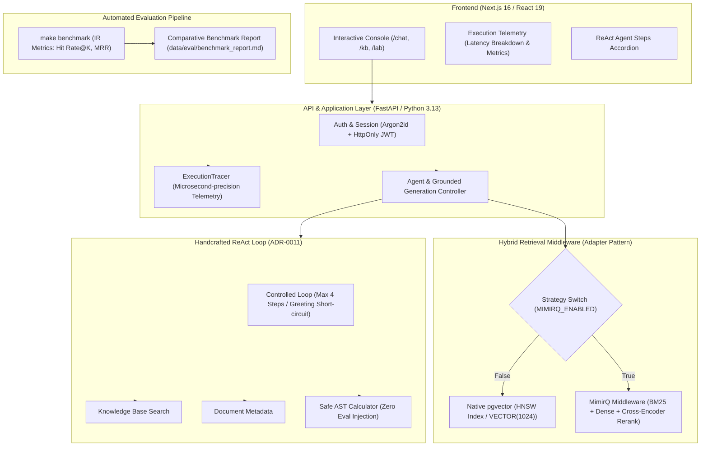

# Enterprise RAG Assistant · enterprise-rag-assistant

[English](README_EN.md) | [简体中文](README.md)

> A production-grade enterprise knowledge base question-answering and multi-step ReAct agent orchestration platform built with **FastAPI**, **Next.js 16**, **PostgreSQL 17 (pgvector)**, and **MimirQ Hybrid Retrieval Middleware**.
> Answers strictly grounded in retrieved evidence with exact file, section, and page-level citations; strictly refuses to answer when evidence is insufficient (100% anti-hallucination guarantee).

---

## Architecture Overview



---

## Tech Stack

| Layer | Technologies |
|:---|:---|
| **Frontend** | Next.js 16 (App Router) · React 19 · TypeScript · Tailwind CSS 4 · TanStack Query · Lucide Icons |
| **Backend** | Python 3.13 · FastAPI · Pydantic v2 · SQLAlchemy 2.0 (Async) · Alembic |
| **Vector & Data** | PostgreSQL 17 + `pgvector` 0.8.6 (HNSW Index) + `pg_trgm` · Redis 7 (AOF Persistence) |
| **Retrieval Middleware** | Native pgvector cosine similarity + MimirQ Enterprise Hybrid Retrieval (BM25 / Vector / Reranker) |
| **Agent Core** | Handcrafted ReAct loop · Python `ast` syntax-tree white-listed arithmetic evaluator |
| **Evaluation & Tracing** | Standard IR metrics (Hit Rate@K, MRR, Refusal Accuracy) · Custom `ExecutionTracer` |
| **Testing & Quality** | pytest (120 test suite) · Playwright E2E · Ruff · ESLint · TypeScript `tsc` |
| **Deployment** | Multi-stage Docker builds · Docker Compose · GitHub Actions CI |

---

## Core Capabilities & Engineering Highlights

### 1. Hybrid Retrieval Middleware & Adapter Pattern (Route B, ADR-0012)
- **Decoupled Search Interface**: Implemented `MimirQSearchService` and `VectorSearchService` adhering strictly to an immutable contract: `search(session, kb_id, query, top_k, min_score) -> tuple[SearchResult, ...]`.
- **Hot-swappable Ingestion & Search**: One-click toggling via `MIMIRQ_ENABLED=true/false` without modifying downstream generation logic.
- **Multi-pass Retrieval**: Combines BM25 lexical inverted indexing, dense vector representations, and Cross-Encoder neural reranking to eliminate vocabulary mismatch and density dilution on specific domain terms.

### 2. Handcrafted ReAct Agent Orchestration (ADR-0011)
- **Zero Black-box Frameworks**: Replaced heavy frameworks (LangChain / LlamaIndex) with a lightweight, deterministic ReAct orchestration loop.
- **Safety First**: Tool invocations execute in a restricted environment; arithmetic queries are parsed into AST trees (`ast.parse`) with whitelisted operator nodes, strictly preventing arbitrary code execution.
- **Controlled Step Execution**: Hard cap of 4 iterative steps with automatic fallback to explicit refusal upon step exhaustion.

### 3. Rigorous Evaluation Benchmark (Eval Pipeline)
- **Standardized IR Metrics**: Built-in evaluation suite assessing Hit Rate@1/3/5, Mean Reciprocal Rank (MRR), and unanswerable negative refusal accuracy.
- **Automated CLI**: Run `make benchmark` (or `python scripts/run_benchmark.py`) to generate side-by-side comparative reports.
- **Empirical Results**:
  | Strategy | Hit Rate@1 | Hit Rate@3 | Hit Rate@5 | MRR | Refusal Accuracy | Avg Latency |
  | :--- | :---: | :---: | :---: | :---: | :---: | :---: |
  | **Naive Dense Vector** | 44.44% | 77.78% | 100.0% | 0.6556 | 100.0% | 71.2ms |
  | **MimirQ Hybrid (BM25+Dense+Rerank)** | **77.78%** | **100.0%** | **100.0%** | **0.8889** | **100.0%** | 97.4ms |

### 4. Full-stack Execution Tracing & Observability
- **Microsecond Timings**: `ExecutionTracer` records distributed trace IDs, vector retrieval duration, LLM generation time (TTFT), retrieved chunk counts, and top confidence scores.
- **Visual Telemetry**: The interactive `/chat` interface displays live telemetry badges under every assistant message.

### 5. Multi-format Document Ingestion
- **Formats Supported**: PDF (page-aware text extraction), DOCX (heading hierarchy & table rows), Markdown (CommonMark structure), TXT (UTF-8, GB18030, Big5).
- **Bounded Chunking**: Token-aware chunking using `tiktoken`'s `cl100k_base` with configurable overlap and hard boundaries at headings and page breaks.

---

## Quick Start

### Prerequisites
- Python 3.13+
- Node.js 22+
- [uv](https://docs.astral.sh/uv/)
- Docker & Docker Compose

### Local Development Setup

```bash
# 1. Clone repository
git clone https://github.com/chenfugui0416/enterprise-rag-assistant.git
cd enterprise-rag-assistant

# 2. Setup environment and install dependencies
make setup

# 3. Start PostgreSQL (pgvector) and Redis
make up-infra

# 4. Start backend and frontend in development mode
make dev
```

Once started:
- **Web Application**: http://localhost:3000
- **Interactive Chat & Agent Console**: http://localhost:3000/chat
- **Knowledge Base Management**: http://localhost:3000/kb
- **Document Chunking Playground**: http://localhost:3000/lab
- **API Documentation**: http://localhost:8000/docs

---

## Testing & Quality Gates

The repository maintains a strict quality bar verified on every commit:

```bash
# Code style and type checks
make lint          # Backend ruff check/format + Frontend eslint & typecheck

# Full test suite
make test          # Executes all 120 unit and integration tests

# Run evaluation benchmark
make benchmark     # Generates A/B evaluation report at data/eval/benchmark_report.md
```

---

## Project Structure

```
enterprise-rag-assistant/
├── apps/
│   ├── api/                      # FastAPI Backend
│   │   ├── app/
│   │   │   ├── api/routes/       # REST routes (/demo, /auth, /health, /documents)
│   │   │   ├── core/             # Configuration & security settings
│   │   │   ├── models/           # SQLAlchemy models (User, KB, Document, Chunk)
│   │   │   ├── rag/
│   │   │   │   ├── agent/        # ReAct agent loop and safe tools (ADR-0011)
│   │   │   │   ├── chunking/     # Bounded token chunking
│   │   │   │   ├── evaluation/   # Benchmark evaluation runner & IR metrics
│   │   │   │   ├── generation/   # Grounded citation generation & refusal
│   │   │   │   ├── loaders/      # Document loaders (PDF, DOCX, MD, TXT)
│   │   │   │   ├── observability.py # ExecutionTracer telemetry
│   │   │   │   └── retrieval/    # VectorSearchService & MimirQSearchService (ADR-0012)
│   │   │   └── schemas/          # Pydantic v2 validation contracts
│   │   └── tests/                # 120 automated test cases
│   └── web/                      # Next.js 16 Frontend
│       ├── src/app/(app)/        # App routes: /chat, /kb, /lab
│       ├── src/components/       # UI components & AppShell
│       └── e2e/                  # Playwright end-to-end tests
├── data/                         # Evaluation datasets & demo corpus
├── docs/                         # ADRs, Status logs, Architecture decisions
└── Makefile                      # Unified developer workflow targets
```

---

## License

MIT License. Designed and developed by [Chen Qizhou](https://github.com/chenfugui0416).
