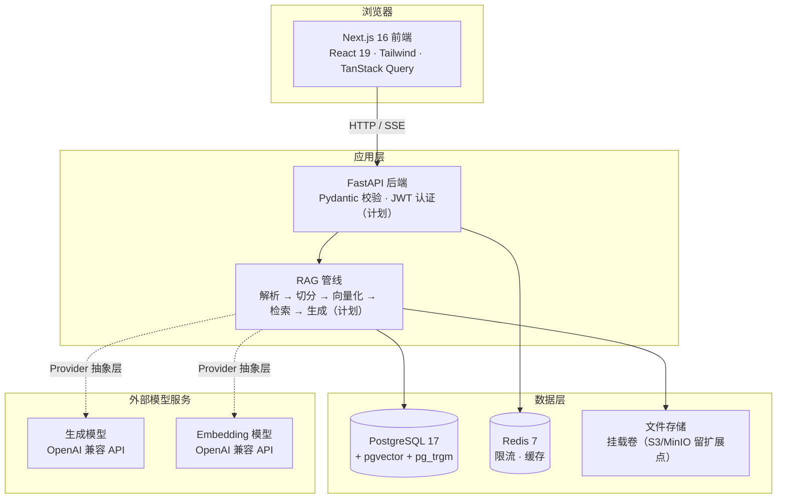
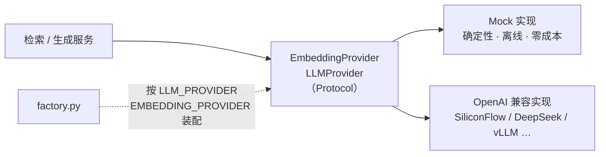

# 架构说明

> 当前实现范围见 `docs/STATUS.md`。本文中标注「计划」的部分尚未实现，不得作为已完成
> 能力对外描述。

## 系统全貌



## Provider 抽象（已实现）

业务代码只依赖 `app/rag/providers/base.py` 中的两个 Protocol，永远看不到具体厂商。



设计要点：

- **切换厂商只改环境变量**：`*_BASE_URL` / `*_API_KEY` / `*_MODEL` 三个变量。
- **Mock 的确定性是刻意设计**：同一文本永远得到同一向量，且已做 L2 归一化，使余弦相似度
  等价于内积，与 pgvector 的行为一致。因此切分、入库、检索、引用装配这些与语义无关的
  环节可以在无 Key 的情况下被断言。
- **失败在装配阶段暴露**：`openai_compatible` 缺 Key 时构造即抛错，而不是等到线上第一次
  请求才失败。
- **错误信息脱敏**：Provider 抛出的异常只保留异常类型与 HTTP 状态码，不携带 URL、请求头
  或文档正文（见 `openai_compatible.py` 的 `_redact`）。
- **兼容性防御**：上游不保证 embedding 返回顺序，按 `index` 排序后再取值；维度与
  `EMBEDDING_DIM` 不符时立即报错，避免脏向量写库。

## 目录职责

```text
apps/api/app/
├── api/routes/     HTTP 路由，只做参数校验与响应装配
├── core/           配置、日志、安全等横切关注点
├── models/         SQLAlchemy 数据模型（计划）
├── schemas/        Pydantic 请求/响应模型（计划）
├── services/       业务编排层
└── rag/
    ├── providers/  模型 Provider 抽象与实现（已实现）
    ├── loaders/    PDF / DOCX / MD / TXT 解析（计划）
    ├── chunking/   结构化切分（计划）
    ├── retrieval/  向量检索、混合检索、重排（计划）
    ├── generation/ 提示词装配、引用、拒答（计划）
    └── evaluation/ 离线评测（计划）

apps/web/src/
├── app/            App Router 页面与 Providers
└── lib/            API 客户端与共享类型
```

分层原则：路由不写业务逻辑，服务层不直接拼 SQL 字符串，RAG 管线不感知 HTTP。

## 运行拓扑

| 环境 | 前端 | 后端 | 数据库 | Redis |
|---|---|---|---|---|
| 本地开发 | `localhost:3000`（热重载） | `localhost:8000`（热重载） | 容器，暴露 5432 | 容器，暴露 6379 |
| e2e 测试 | `127.0.0.1:3100`（standalone 产物） | `127.0.0.1:8100`（mock provider） | 不依赖 | 不依赖 |
| 生产（VPS） | 容器 `:3000` | 容器 `:8000` | 容器，**不对外暴露端口** | 容器，**不对外暴露端口** |

e2e 使用独立端口，因此可以与 `make dev` 同时运行而不冲突。

## 关键约束

- `NEXT_PUBLIC_*` 在**构建时**被内联进客户端产物，因此前端镜像的 API 地址必须通过
  build arg 传入，运行时改环境变量无效。
- 容器间互访用服务名（`db`、`redis`），浏览器直连后端必须用宿主机可达地址，两者不能混用。
- 数据库初始化脚本只在数据卷为空时执行一次；已有卷上新增扩展需手工执行或走迁移。
